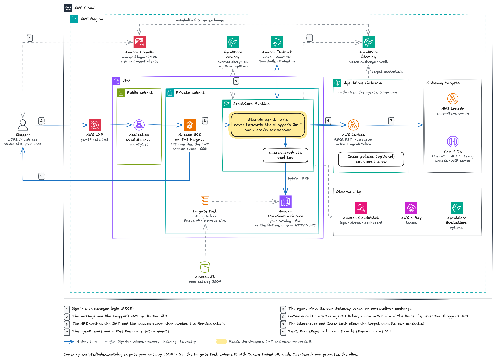
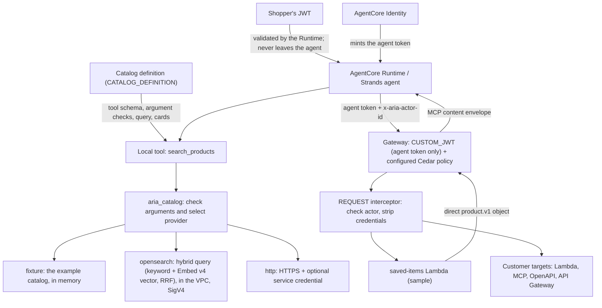
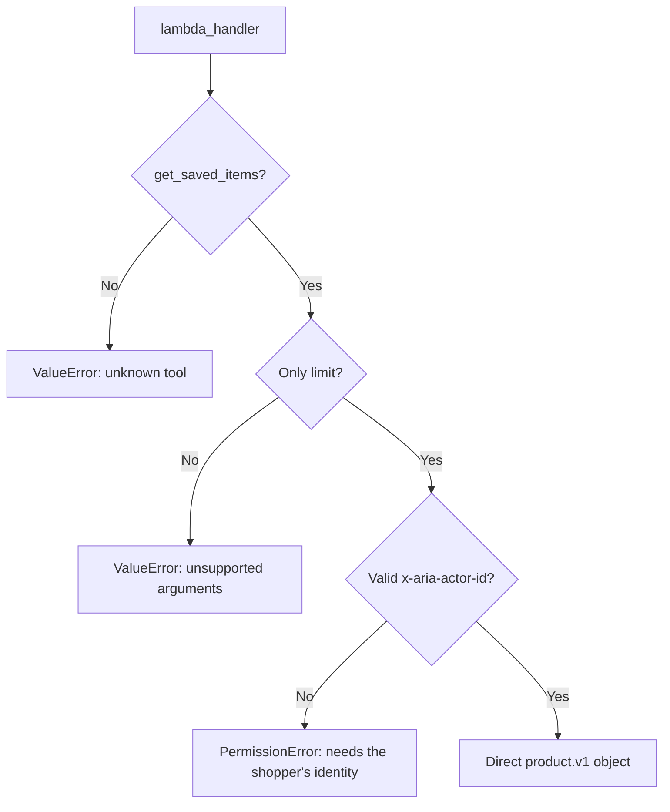
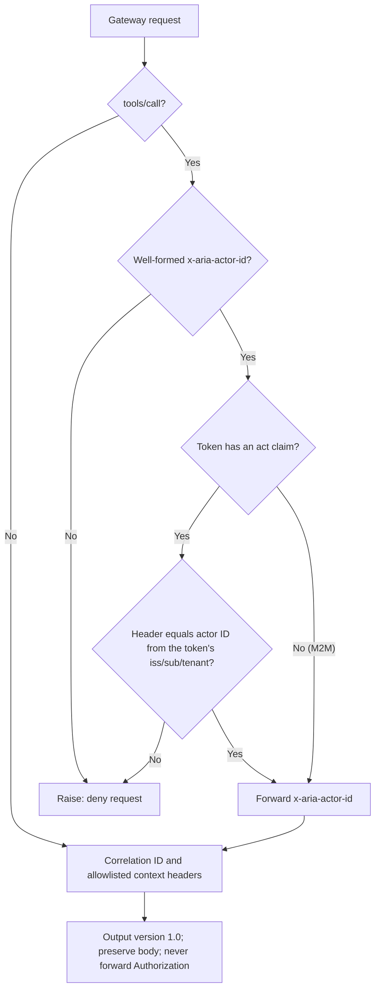
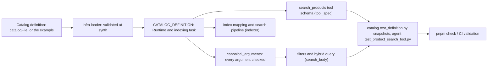

# Architecture

ARIA is a shopping assistant that customers deploy and extend. A Nuxt web app talks to a FastAPI service, which invokes a Strands agent on Amazon Bedrock AgentCore Runtime. The agent answers with a Bedrock model, runs frequent tools in-process, and reaches the remaining tools through AgentCore Gateway with a token of its own. One CDK app deploys the backend; the storefront is a static SPA you host.



The numbers follow one chat turn, which [a turn, end to end](#a-turn-end-to-end) describes in prose. The drawing's source is `docs/architecture/aria-architecture.mjs`, rendered with the excalidraw-aws-arch plugin's `draw.mjs`; to edit by hand, open `aria-architecture.en.excalidraw` at <https://excalidraw.com>. The Korean version sits beside it (`.ko`).

## Packages and layering

| Package | Role | Depends on |
| --- | --- | --- |
| `packages/contracts` | Shared identity and session rules (actor ID derivation, principal-bound session IDs) and the turn events the agent streams and the API relays (`aria_contracts.events`) | nothing |
| `packages/catalog` | Catalog search from a catalog definition: the tool schema, argument checks, the index, pipeline and hybrid query, cards; Cohere Embed v4; the fixture, OpenSearch and HTTP providers; the example catalog | boto3, opensearch-py; the definition module only the standard library |
| `packages/agent` | The Strands agent on AgentCore Runtime: model, local tools, the Gateway token, tool safety, Memory | contracts, catalog |
| `packages/api` | Verified bearer identity, session ownership, Runtime invocation, SSE to the browser | contracts |
| `packages/web` | Nuxt SPA: sign-in, chat, product cards | the API over HTTPS |
| `packages/indexer` | The catalog indexing job, a Fargate task in the VPC: validates, embeds and loads a catalog into a versioned index, then moves the alias | catalog |
| `packages/mcp-servers` | Gateway Lambdas: the REQUEST interceptor and the saved-items sample | interceptor: stdlib only; saved-items: catalog |
| `packages/infra` | The CDK app: every stack, configuration validation, alarms | catalog's definition module at synth; the other packages as build contexts |

Rules the layering relies on:

- **The browser talks only to the API.** It never calls the Runtime or the Gateway, and never sees the agent's token.
- **The API and the agent don't import each other.** They meet at the Runtime invocation and the contracts package, which defines every frame and error code on both hops.
- **Identity rules live in `contracts`.** The interceptor keeps a stdlib-only copy of the actor-ID derivation, tested against the contract's reference values.
- **`infra` imports only the catalog definition.** `aria_catalog.definition`, standard library only, validates the stage's definition at synth and serializes it for the Runtime and the indexing task. Every other package reaches CDK as an image context or a Lambda asset.

## Stacks

One CDK app (`packages/infra/app.py`) creates, per stage namespace such as `ARIADev`:

| Stack | Contents | Present when |
| --- | --- | --- |
| `Vpc` | Network for the API, the Runtime (always in VPC mode) and OpenSearch | always (or an existing VPC) |
| `Auth` | Cognito user pool, web and agent clients, the Gateway credential provider | `auth.provider = "cognito"` |
| `Opensearch` | The catalog's OpenSearch 3.5 domain, the Nori plugin, the private catalog bucket and the indexing task | `tools.productSearch.provider = "opensearch"` |
| `Gateway` | AgentCore Gateway, interceptor, targets, Cedar policy engine | `gateway.mode = "managed"` |
| `AgentRuntime` | The Runtime, its role and image, Memory, Guardrail | always |
| `CommonApp` | The application load balancer | always |
| `ApiService` | The API on ECS Fargate | always |
| `Operations` | Alarms and the dashboard | always |
| `Evaluations` | Online AgentCore Evaluations | `evaluations.enabled = true` |

Stacks reference each other through CloudFormation exports. A stack can't delete an export another stack still imports, so a cross-stack reference also fixes deploy order; see [deployment safety](docs/design-docs/deployment-safety.md).

## A turn, end to end

1. The web app sends the shopper's message with their access token to the API.
2. The API verifies the token, checks the session belongs to the shopper, and invokes the Runtime with the same token.
3. The Runtime verifies the token again, and hands the agent a workload access token for the shopper.
4. The agent runs the model. Local tools run in-process. Gateway tools go out with the agent's own token, minted from the workload token, and `x-aria-actor-id`.
5. The Gateway checks the agent's token. The interceptor checks the actor ID and, when enabled, Cedar authorizes the call; both must allow it. The target runs with its own credentials.
6. Events stream back through the API to the browser as server-sent events.

[Where a tool belongs](docs/design-docs/tool-placement.md) and [identity and tokens](docs/design-docs/identity-and-tokens.md) explain steps 4 and 5. The diagrams below trace the tool paths in detail.

## 1. System architecture



Product search never leaves the agent, so it skips the Gateway hop; with OpenSearch, a query also makes one Embed v4 call to Bedrock. The Runtime always runs in the VPC's private subnets. The OpenSearch domain, its 443 rule for the Runtime, the catalog bucket and the indexing task exist only for that provider, and fixture/HTTP searches need no domain. The saved-items sample is created only when `gateway.savedItemsSample` is on (the Dev template).

## 2. Gateway tool call

```mermaid
sequenceDiagram
    participant R as Runtime
    participant A as Agent
    participant ID as AgentCore Identity
    participant G as Gateway
    participant I as Interceptor
    participant L as Saved-items Lambda
    R->>A: Request with the shopper's JWT and a WorkloadAccessToken
    A->>A: Derive the actor ID from the JWT; check session ownership
    A->>ID: GetResourceOauth2Token (on-behalf-of or M2M), cached until near expiry
    ID-->>A: Agent token (on-behalf-of: sub = shopper, act.sub = agent)
    A->>G: tools/call saved-items___get_saved_items + agent token + x-aria-actor-id
    G->>G: Verify the agent token (audience/client and scope) / apply Cedar policy
    G->>I: REQUEST with gatewayRequest headers and body
    I->>I: Check x-aria-actor-id; for on-behalf-of, match the token's subject
    I-->>G: Version 1.0 / actor, correlation and allowlisted headers; no Authorization
    G->>L: Tool arguments + context metadata (propagated headers)
    L-->>G: schemaVersion, count, products
    G-->>A: MCP content
```

The shopper's JWT never reaches the Gateway. The tool name and propagated headers are in Lambda context metadata; the event contains only tool arguments. Gateway creates the result envelope; the handler does not return an HTTP proxy wrapper.

## 3. Saved-items error handling



The local search tool reports invalid arguments, undeclared values and unknown parameters alike, as actionable errors, and unexpected backend failures as `Product search failed`, with details kept in restricted logs.

## 4. Interceptor decisions



Check failures and exceptions reject the request. `pass_request_headers=True` exposes Gateway headers to the interceptor, and each target's `allowedRequestHeaders` lists the headers it receives. Lambda targets read them from `bedrockAgentCorePropagatedHeaders`. Custom headers must reach the Runtime directly or through a custom integration: the shipped API does not forward them.

## 5. Schema synchronization



The model sees the schema generated from the stage's catalog definition, and `aria_catalog` checks the model's arguments against the same definition, so the two can't drift. The index the job builds and the query the tool sends come from it too. The tests snapshot the example's schema, mapping, pipeline and query, and check every declared value is listed and accepted.

## 6. Catalog indexing

```mermaid
flowchart LR
    Catalog["Customer catalog: JSON or JSONL"] --> Script["scripts/index_catalog.sh: dry run by default"]
    Script -->|"--apply: upload"| Bucket["Private catalog bucket, catalog/ prefix"]
    Bucket --> Task["Indexing task: Fargate in the VPC"]
    Task --> Validate["Validate against the definition"]
    Validate --> Embed["Embed v4, 96 per call"]
    Embed --> Version["New versioned index: bulk load, count check"]
    Version --> Pipeline["Put the RRF search pipeline"]
    Pipeline --> Alias["Move the alias in one _aliases call"]
    Alias --> Search["Agent search tool reads the alias"]
    Fixture["Example catalog"] -->|"fixture provider; no indexing"| Search
```



Without `--apply`, nothing is written: the script validates a local file on the operator's machine, and the task an `s3://` one. A failure before the alias moves leaves it where it was, and the new index stays unpromoted, since the task can't delete indexes. See the [catalog runbook](docs/guides/operations.md#catalog-runbook).
