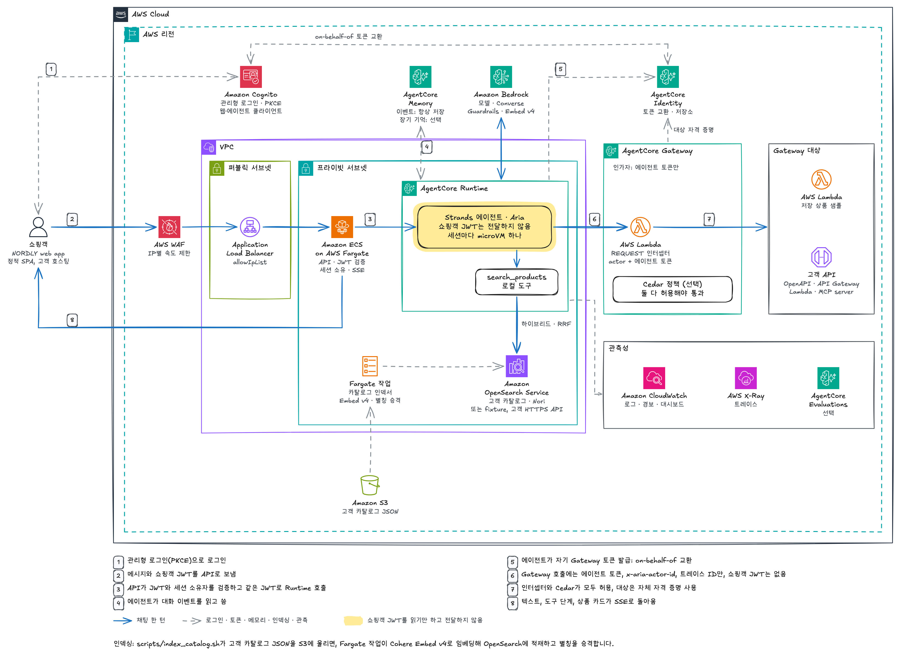

# ARIA

[English](README.md)

통합 방식을 선택할 수 있는 쇼핑 어시스턴트 참조 구현입니다. Strands 에이전트는 Amazon Bedrock AgentCore Runtime에서 실행되고 대화는 AgentCore Memory에 저장됩니다. 관리형 Cognito 또는 자체 OIDC IdP를 사용합니다. 패키지에 포함된 예제 카탈로그, 키워드와 Cohere Embed v4 벡터를 함께 쓰는 하이브리드 검색으로 OpenSearch에 둔 자체 카탈로그, 또는 HTTPS 카탈로그 API를 검색하며, 각각을 카탈로그 정의로 설명합니다. Lambda 도구, 원격 MCP 서버 또는 기존 AgentCore Gateway를 연결할 수 있습니다.

에이전트와 Memory는 고정 구성 요소이며 공급자/어댑터 모드가 없습니다. AgentCore가 세션 수명 주기를 관리하고, 애플리케이션은 세션 데이터베이스 없이 인증 주체에 연결된 세션 ID로 소유권을 검증합니다.

**NORDLY**는 UI에 포함된 예제 쇼핑몰입니다. 데모 카탈로그용 임시 브랜드이며 구성 요소가 아닙니다. [쇼핑몰 이름 변경](docs/guides/getting-started.ko.md#쇼핑몰-이름-변경)을 참고하세요.

## 패키지

| 패키지 | 역할 |
|---|---|
| `agent` | 고정된 쇼핑 에이전트, Bedrock Converse, 로컬 도구(상품 검색), 에이전트가 발급받는 Gateway 토큰, 도구 권한과 요청 예산 |
| `api` | bearer 신원 검증, 세션 소유권, 비동기 Runtime 전송, 기록 |
| `web` | Nuxt SPA, OIDC 인증 코드 + PKCE, 버전이 있는 SSE, 예제 쇼핑몰 상품 카드 |
| `catalog` | 에이전트의 로컬 도구, 인덱서, Gateway 예제가 함께 쓰는 카탈로그 정의 기반 검색: 도구 스키마, 하이브리드 쿼리, 공급자, Embed v4, 예제 카탈로그 |
| `indexer` | 카탈로그 인덱싱 작업: 카탈로그를 임베딩해 버전 OpenSearch 인덱스에 적재하는 VPC 안의 Fargate 태스크 |
| `mcp-servers` | Gateway 인터셉터와 saved-items 예제 대상 |
| `infra` | CDK 구성, 관리형/BYO 선택, Dev/Prod 검증, 경보 |
| `contracts` | 공통 ID/세션 통신 계약. AWS 작업 없음 |

## 문서

[시작하기](docs/guides/getting-started.ko.md)부터 읽으세요. [가이드](docs/guides/index.ko.md)는 통합, 확장, 릴리스, 운영을 다룹니다. 구현 방식과 이유는 [ARCHITECTURE.md](ARCHITECTURE.md)와 [설계 문서](docs/design-docs/index.md)에서, 제품이 해야 할 일은 [제품 명세](docs/product-specs/index.md)에서 설명합니다(영어). [QUALITY_SCORE.md](docs/QUALITY_SCORE.md)는 검증된 부분과 부족한 부분을 평가합니다. 코딩 에이전트는 [AGENTS.md](AGENTS.md)에서 시작합니다.

가이드와 README에는 한국어 문서(`.ko.md`)가 따로 있으므로 함께 수정하세요. 설계 문서, 명세, 참고 자료는 영어로만 작성합니다.

API, 에이전트, 인덱서 이미지는 고정된 베이스 다이제스트와 잠금된 운영 의존성을 사용합니다. API는 `CUSTOM_JWT` Runtime에 HTTPS bearer로 접근하며 사용자 호출 경로에서 IAM/SigV4를 사용하지 않습니다. 프롬프트 캐싱은 기본적으로 꺼져 있고 OpenAI Bedrock Converse 캐싱은 활성화할 수 없습니다. 지속적 AgentCore 평가는 명시적 활성화, 검증된 트레이스 전달, 콘텐츠 수집 승인이 필요합니다.

## 보안

자세한 내용은 [CONTRIBUTING](CONTRIBUTING.md#security-issue-notifications)을 참고하세요.

## 라이선스

이 라이브러리는 MIT-0 라이선스를 따릅니다. [LICENSE](LICENSE) 파일을 참고하세요.
