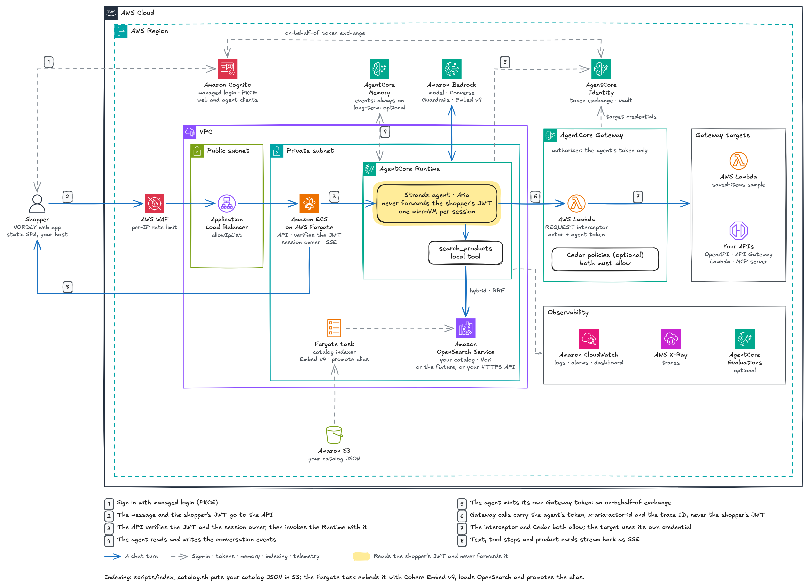

# ARIA

[한국어](README.ko.md)

A pluggable shopping-assistant reference implementation. The Strands agent runs on Amazon Bedrock AgentCore Runtime, and AgentCore Memory stores its conversations. Use managed Cognito or your own OIDC IdP. Search the packaged example catalog, your own catalog in OpenSearch with hybrid keyword and Cohere Embed v4 vector search, or your HTTPS catalog API, each described by a catalog definition. Connect Lambda tools, remote MCP servers, or an existing AgentCore Gateway.

The agent and Memory are fixed — neither has provider or adapter modes. AgentCore owns session lifecycle, and the application verifies ownership through principal-bound session IDs without a session database.

**NORDLY** is the sample storefront the UI ships with: a placeholder brand for the demo catalog, not a component. See [Renaming the storefront](docs/guides/getting-started.md#renaming-the-storefront).

## Packages

| Package | Responsibility |
|---|---|
| `agent` | Fixed shopping agent, Bedrock Converse, local tools (product search), the agent's minted Gateway token, tool permissions and request budgets |
| `api` | Verified bearer identity, session ownership, asynchronous Runtime transport, history |
| `web` | Nuxt SPA, OIDC authorization code + PKCE, versioned SSE, sample storefront product cards |
| `catalog` | Catalog search from a catalog definition, shared by the agent's local tool, the indexer and the Gateway sample: the tool schema, the hybrid query, providers, Embed v4 and the example catalog |
| `indexer` | The catalog indexing job: a Fargate task in the VPC that embeds a catalog and loads a versioned OpenSearch index |
| `mcp-servers` | Gateway interceptor and the saved-items sample target |
| `infra` | CDK composition, managed/BYO selections, Dev/Prod validation, alarms |
| `contracts` | Shared identity/session wire contract; no AWS operations |

## Documentation

Start with [Getting started](docs/guides/getting-started.md). The [guides](docs/guides/index.md) cover integrating, extending, releasing and operating ARIA. [ARCHITECTURE.md](ARCHITECTURE.md) and the [design docs](docs/design-docs/index.md) explain how it's built, and the [product specs](docs/product-specs/index.md) say what it should do. [QUALITY_SCORE.md](docs/QUALITY_SCORE.md) grades what's solid and what isn't. Coding agents start at [AGENTS.md](AGENTS.md).

Guides and READMEs have Korean twins (`.ko.md`); update both together. Design docs, specs and references are English only.

The API, agent and indexer images use pinned base digests and frozen production dependencies. The API uses HTTPS bearer transport to a `CUSTOM_JWT` Runtime; IAM/SigV4 is not used for its user invocation path. Prompt caching is off by default; OpenAI Bedrock Converse caching cannot be enabled. Continuous AgentCore Evaluations is opt-in and requires verified trace delivery and explicit content-capture approval.

## Security

See [CONTRIBUTING](CONTRIBUTING.md#security-issue-notifications) for more information.

## License

This library is licensed under the MIT-0 License. See the [LICENSE](LICENSE) file.
